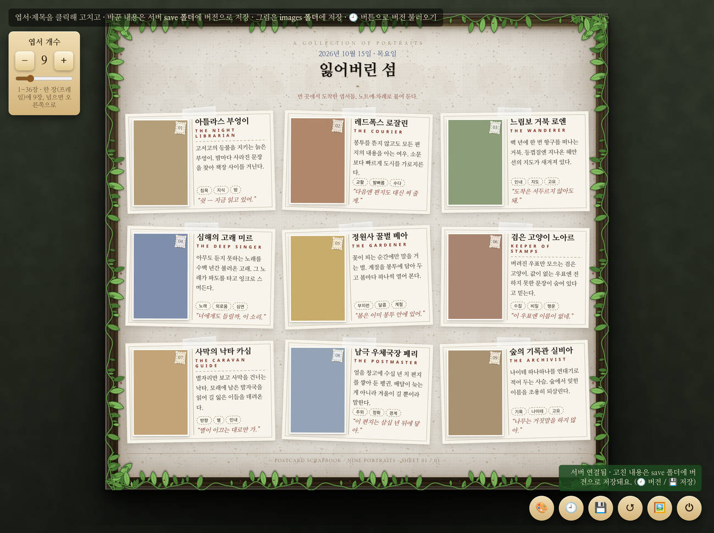
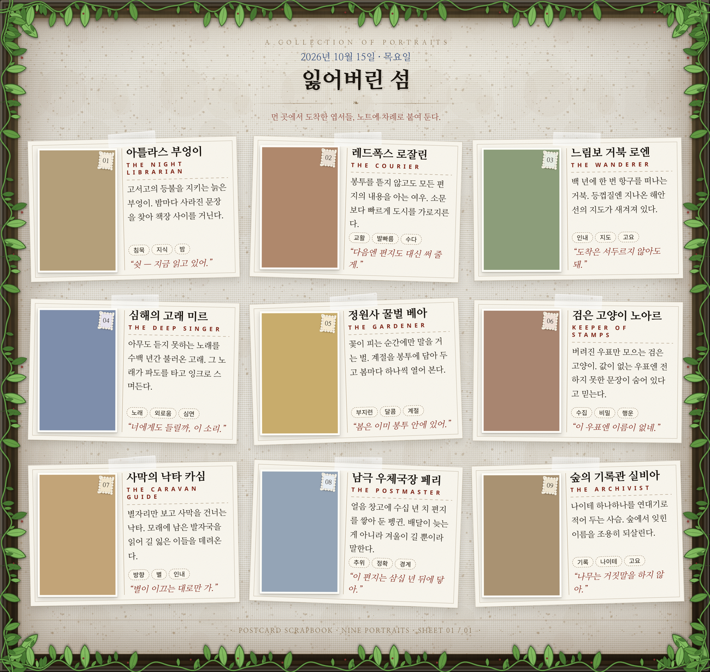

# 인형 메뉴판 만들기 (doll menu maker)

> ⚠️ **이 저장소(코드 · 문서 · 예시 이미지)는 AI가 작성/생성했으며, 사람이 검수하지 않았습니다.**
> 동작이나 설명이 실제와 다를 수 있으니 참고용으로만 확인해 주세요.

인형(캐릭터) 사진과 소개를 **빈티지 엽서 카드** 모양으로 액자 안에 붙여,
**한 장의 이미지(메뉴판)로 저장**할 수 있는 로컬 웹 도구입니다.

- 인터넷 없이 동작합니다. (글꼴까지 내장)
- 파이썬 표준 라이브러리만 씁니다. (별도 패키지 설치 불필요)
- 윈도우에서는 **더블클릭으로 실행되는 exe**로도 쓸 수 있습니다.

## 미리보기

> 아래 이미지는 기본 템플릿의 **더미 데이터**(그림 없이)로 만든 예시입니다.

화면 (앱):


🖼️ 로 저장한 완성 메뉴판 PNG:


---

## 1) 무엇을 만들 수 있나요

큰 나무 액자 안에 엽서 모양 카드가 격자로 걸려 있고,
카드마다 **인형 사진 + 이름 · 부제 · 소개 · 특징 · 한마디**가 들어갑니다.
한 프레임(액자)에 **9장(3×3)**, 넘으면 오른쪽으로 새 프레임이 생깁니다. (최대 36장)

- 카드를 클릭해 내용을 고치고
- 마음에 드는 **테마**(색·질감·글씨)를 고르고
- 완성되면 **프레임마다 PNG 이미지로 저장**합니다.

---

## 2) 빠르게 실행하기

### 소스로 실행 (파이썬이 있을 때)

```bash
python3 server.py            # http://localhost:8899/ 가 열립니다
```

- `python3 server.py --open` : 실행 후 브라우저 자동 열기
- `python3 server.py 8000`   : 포트 지정
- `python3 server.py --new`  : 이미 켜져 있어도 새로 띄우기

종료는 실행한 **터미널에서 `Ctrl+C`** 입니다. (파이썬으로 직접 실행했을 땐 ⏻ 버튼은 의미가 없어요)

### 윈도우 exe (파이썬 없이)

`doll_menu_maker.exe` 를 더블클릭하면 창 없이 서버가 켜지고 브라우저가 열립니다.
exe 를 직접 만들려면 **[BUILD_WINDOWS.md](BUILD_WINDOWS.md)** 를 참고하세요.
(윈도우에서 `build_windows.bat` 더블클릭, 또는 GitHub Actions 로 자동 빌드)

> 저장 데이터는 exe 옆 `save\` 폴더에 쌓입니다. **바탕화면·문서처럼 쓰기 가능한 폴더**에 두세요.

> **서버는 중복 실행되지 않습니다.** 이미 서버가 켜져 있는데 exe 를 또 실행하면,
> 새 서버를 만들지 않고 **켜져 있는 서버의 화면을 브라우저로 다시 열어만 줍니다.**
> (작업하던 내용이 그대로 이어집니다. 일부러 새로 띄우려면 `--new`)
>
> **완전히 끄려면** 페이지 오른쪽 위 **⏻ (서버 종료)** 버튼을 누르세요.
> 브라우저 창만 닫으면 서버는 백그라운드에서 계속 살아 있습니다.
> 단, **파이썬에서 직접 실행**(`python3 server.py`)했을 때는 ⏻ 버튼이 의미가 없습니다 —
> 실행한 **터미널에서 `Ctrl+C`** 로 끄세요.

---

## 3) 사용법

오른쪽 아래 버튼들:

| 버튼 | 하는 일 |
|---|---|
| 🎨 | **테마** 바꾸기 (클래식 / 모던시크 / 할로윈) — 화면 미리보기 |
| 🕘 | **저장 버전** (불러오기 · 별칭 · 삭제, 최대 5개) |
| 💾 | 지금 슬롯에 **저장** (단축키 **Ctrl+S**) |
| ↺ | 처음 상태로 되돌리기 |
| 🖼️ | **프레임마다 PNG 이미지로 저장** |
| ⏻ | 서버 종료 (앱 닫기) |

왼쪽 위:

- **엽서 개수** 1~36 (한 프레임에 9장, 넘으면 오른쪽 새 프레임)
- 프레임이 2개 이상이면 아래 가운데 **‹ 1 / 2 ›** 로 프레임 이동

편집:

- **카드**를 클릭 → 이름 · 부제 · 소개 · 특징 · 한마디 · 그림 · 그림 색
- 그림은 파일을 올려 **자르기(드래그 + 확대 슬라이더)** 로 그림칸에 맞춥니다
- **제목/머리말**을 클릭 → 윗줄 · 날짜 · 제목 · 한 줄 소개 · 바닥글
- 카드를 **드래그**해 순서를 바꿀 수 있어요

> 빈 칸으로 저장하면 기존 값이 그대로 유지됩니다.

---

## 4) 테마

큰 틀(액자 + 엽서 배치)은 그대로 두고 **색 · 질감 · 글씨**만 바뀝니다.

- **classic** — 나무 액자 + 캔버스 마운트 + 아이보리 엽서 (기본)
- **modern** — 블랙앤화이트 · 올고딕 · 장식 없는 단순한 엽서
- **halloween** — 어두운 보라 벽 · 늦은 나무 액자 · 진한 주황 종이, 호박/양초/압정/전구줄 장식

고른 테마는 **화면에만** 미리 적용되고, **💾 저장**할 때 그 버전에 함께 담깁니다.

### 새 테마 추가하기

1. `themes/새이름.css` 에 `html[data-theme="새이름"]{ … }` 규칙 작성
2. `postcard-cards.html` 의 `<head>` 에 `<link rel="stylesheet" href="themes/새이름.css">` 한 줄
3. `postcard-cards.js` 의 `THEMES` 목록에 한 줄

(색·질감은 대부분 CSS 변수만 바꾸면 되고, 필요하면 `html[data-theme="…"] .선택자{…}` 규칙도 쓸 수 있어요)

---

## 5) 이미지로 저장 (PNG)

**🖼️** 를 누르면 **프레임(액자) 한 장당 PNG 한 장**으로 저장됩니다.
(여러 프레임이면 `slot1.png`, `slot1_02.png`, …)

저장은 브라우저가 실제로 그리는 그대로(SVG `foreignObject`) 그리는
**modern-screenshot** 을 씁니다 → **그림자 · 필터(drop-shadow) · 배경 블렌드 · 기울기까지 화면과 동일**.
(불러오지 못하면 html2canvas 로 자동 폴백)

---

## 6) 저장 구조

```
save/
  versions.csv      버전 목록 (slot, alias, file, created)
  slot1/
    index.html      그 버전의 화면
    01.jpg, 02.png  그 버전에서 쓴 그림 (프로필 번호 이름)
  slot2/ …
```

- **저장(💾)** 하면 `save/slotN/` 에 HTML + 그림이 담기고 CSV 가 갱신됩니다. (최대 5슬롯, 넘으면 오래된 것부터 정리)
- 기본 템플릿(`postcard-cards.html`)은 **절대 덮어쓰지 않습니다.** (버전은 슬롯 폴더에 따로)
- 접속(`/`)하면 **가장 최근 슬롯**을 첫 화면으로 보여 줍니다.
- `save/` 는 `.gitignore` 에 들어 있어 저장소에는 안 올라갑니다.

---

## 7) 파일 구조

```
postcard-cards.html   화면(템플릿) — 기본 레이아웃과 편집 창들
postcard-cards.css    스타일 — 레이아웃/엽서/액자/툴바 + 테마 변수
postcard-cards.js     동작 — 편집 · 저장 · 테마 · 이미지 저장
themes/
  classic.css · modern.css · halloween.css
assets/
  fonts/    내장 글꼴 (woff2) + fonts.css   ← 나눔명조·나눔펜·나눔붓글씨·Caveat
  vendor/   html2canvas.min.js, modern-screenshot.js
  textures/ 테마용 SVG (덩굴, 할로윈 호박/양초 등)
server.py             로컬 서버 (정적 제공 + 업로드/저장/버전)
build_windows.bat     윈도우 exe 빌드 (PyInstaller)
BUILD_WINDOWS.md      exe 빌드/사용 안내
.github/workflows/    GitHub Actions 로 exe 자동 빌드
```

---

## 8) 참고

- **오프라인:** 글꼴은 `assets/fonts/` 에 내장돼 있어 인터넷 없이 그대로 보입니다.
- **방화벽:** 서버는 `127.0.0.1`(내 PC 안)으로만 열려 외부에 공개되지 않습니다.
- **외부 라이브러리:** `html2canvas`(MIT), `modern-screenshot`(MIT) — `assets/vendor/` 에 내장.
- **글꼴:** Nanum Myeongjo · Nanum Pen Script · Nanum Brush Script · Caveat (Google Fonts, OFL).
